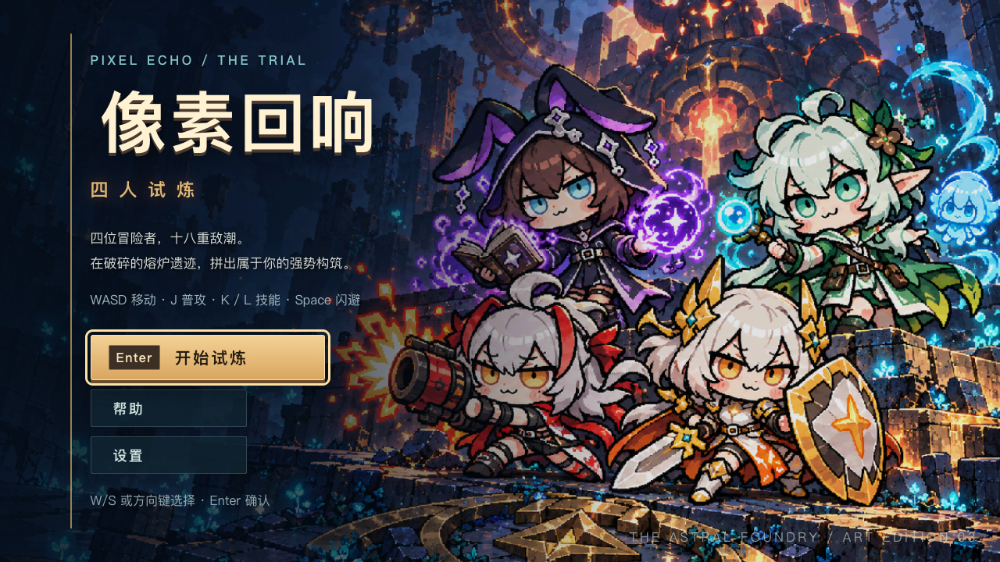
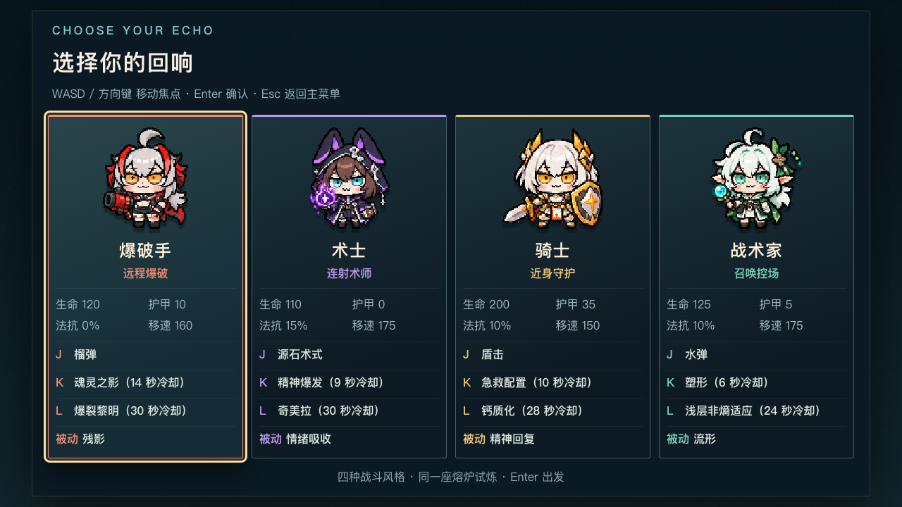
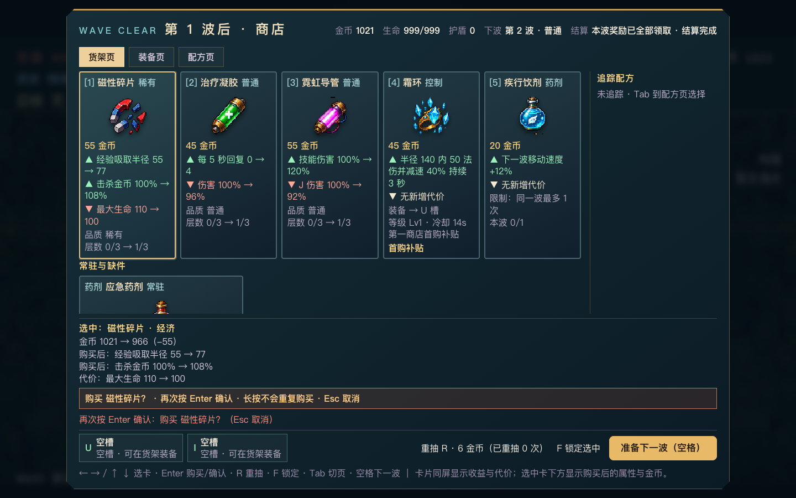
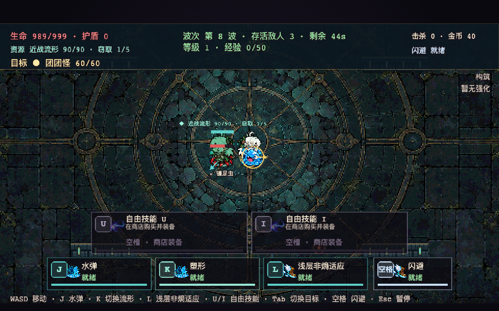
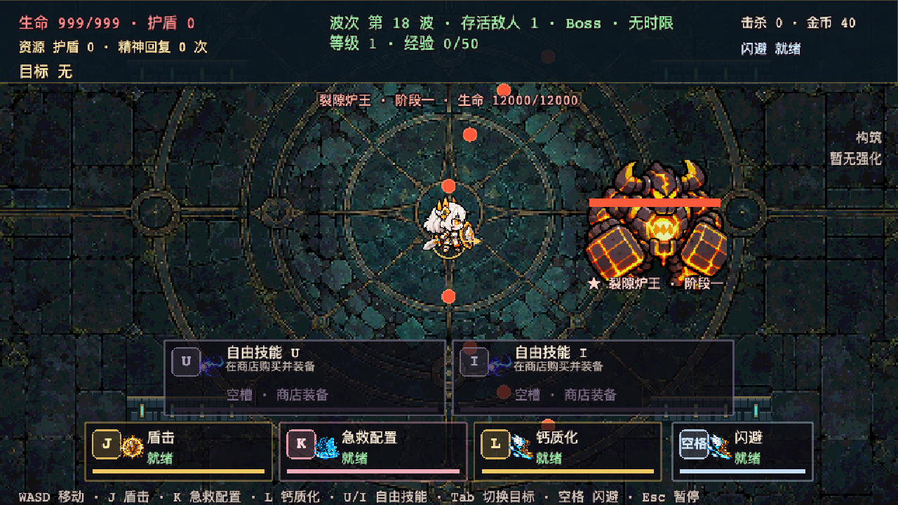

# V0.3 · 星盘熔炉美术版

四位大头短身的冒险者进入冷色石砌遗迹。红黑爆破、紫色术式、白金守护、青绿水形各有自己的角色轮廓；暖金菜单与冷蓝场景共用一套材质语言。





战斗/Boss截图使用开发展示场景，预置生命只用于查看素材，不作为通关记录：




## 已接入游戏的素材

| 资源 | 规格 | 使用位置 |
|---|---|---|
| 四职业方向动作表 | 每人864×480；96×96帧；四向待机/行走/攻击/受击与八向施法槽 | 场内、选角、主流形与副本 |
| 四角色独立预览 | 256×256透明PNG | 素材库预览；选角实际仍读场内同一精灵表 |
| 八种普通怪 | 每种80×80透明PNG | 各自独立剪影；呼吸/蓄力形变与朝向由渲染层驱动 |
| 幼虫 / 裂隙炉王 | 48×48 / 192×192 | 召唤物 / 第18波Boss；阶段二暖色熔岩变化 |
| 地板 / 墙 / 掩体 | 1440×960 / 32×32 / 32×32 | 星盘石板、金属嵌线与晶体掩体；碰撞布局不变 |
| 68枚基础图标 | 每枚64×64透明PNG | 24道具、8药剂、12自由技能、8核心、6配方、货币/宝箱/通用动作 |
| 48种海克斯映射 | 复用相应机制的图标，保留各自名称与品质框 | 海克斯三选一、构筑面板；不是48张另绘原画 |
| 4类×4帧特效 | 512×512表，每帧128×128 | 爆破、冰晶、水涡、奥术的扩散与消散 |
| 标题主视觉 | 1200×800 | 主菜单；标题与按钮是可访问DOM，不烘焙在图里 |

宝箱、便携炮台、水镜替身和额外水形也已从简单圆/矩形改为实际贴图；技能HUD、奖励卡、商店与构筑面板共用同一图标目录。碰撞、数值、CD、商品价格、奖励队列和存档命名空间不因换美术改变。

## 修改与重新生成

- `art/source/`：保留11张生成源图，包括四角色生产方向表、怪物与图标图集、场景和特效。不是运行时依赖。
- `tools/art/png.mjs`：无外部依赖的PNG解码/编码、最近邻采样与图集拼装。
- `tools/art/build-art.mjs`：切分、对齐、生成像素资源和`src/game/art-manifest.ts`。完整路径字面量让单HTML构建能内联全部素材。
- `public/assets/art/`：实际生产贴图；V0.2原资源另存原目录，不覆盖。
- [生成提示词](prompts.md)：原画方向、人物身份和各图集的排列规则。

```bash
npm run art:build     # 从已保存源图重建V0.3素材，不调用模型
npm run assets        # 同时保留兼容旧资源的生成路径
npm run build:share   # 生成完整内联的单HTML
```

生成使用内置ImageGen工具，再进行像素尺寸整理、透明边缘处理与图集装配。墙与掩体由项目内的像素绘制代码生成。没有引入素材站下载包或外链字体。

## 验证边界

类型检查、lint与单元测试已检查美术接线、透明边距、帧布局、碰撞尺寸和全部内容图标的覆盖。界面须看实际浏览器截图，不以PNG存在代替美术验收。开发展示场景仅用于检查画面，不是普通流程通关证据。

用户此前跳过的人工18波试玩与性能/泄漏压力检测仍未补做，不宣称真人通关、目标FPS或无泄漏。参考形象属于《明日方舟》同人方向，非官方合作或商用授权素材。

发布入口与原子更新/回退方法见[部署说明](DEPLOYMENT.md)。用户已明确取消包体大小限制，保留原画清晰度与完整内联，不以3MB/8MB作为发布门槛。
