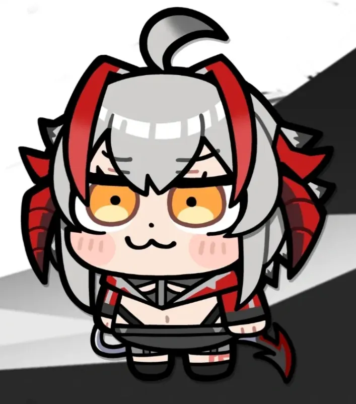

# 人物美术方向：愚人节风格 Q 版像素

2026-10-19 用户新增要求。执行者与 Validator 均须先查看下图，再制作或验收角色资源。

## 选定方向

以用户提供、称为“维什戴尔愚人节皮肤”的这张图为造型基准：大头短身、短小四肢、粗黑轮廓、大眼睛和喜剧表情。它是平涂 Q 版造型参考；游戏资源需重新绘成原生像素画，而不是把附件直接缩小、模糊或覆盖马赛克滤镜。

四名角色采用同一套 Q 版比例与像素语言，但各自保留角色辨识特征和原 PRD 的技能机制。不增加愚人节活动玩法，也不因换造型改变伤害、碰撞或技能方向。

## 画法与资源规格

- 约 1.5–1.8 头身；头部含头发、但不计突出角/耳的高度约占人物主体高度的 60%–70%，身体短而宽，不画细长写实人形。
- 默认采用 **64×64 像素透明帧**，替代旧 32×48 资源规格，给眼睛、发型和角留出空间。脚底锚点一致；保留游戏逻辑碰撞半径 12，不按大头轮廓扩大受击范围。
- 以 1–2 原生像素宽深色描边、成块明暗和少量高光塑形；每个角色建议 16–24 色。使用最近邻显示，不使用平滑缩放、模糊抗锯齿或照片纹理。
- 待机、至少两帧行走、攻击与受击保留同一张脸和轮廓；上/下/左右朝向完整，左右可镜像。武器/方向标记明确表达八向施法，不能为了可爱而牺牲方向可读性。
- 人物至少在正常游戏画面和 4 倍最近邻预览中都能辨认五官与角色身份；头部、角耳、武器不被帧边缘裁掉。
- 不把参考图的白色背景或灰黑装饰一并画进精灵；不把素材说明、角色名或 Emoji 当成人物。

## 四角色的识别点

| 角色 | 保留什么 | Q 版处理 |
| --- | --- | --- |
| 维什戴尔 | 银灰头发与呆毛、红黑角形装饰、黄橙大眼睛、黑红服装、重型发射器 | 最贴近参考图的大头、短腿、腮红与略带呆萌/狡黠的嘴形；武器缩成清晰小轮廓，不挡住整张脸 |
| 阿米娅 | 棕发、长兔耳、黑蓝服装与蓝黑术式 | 同样的大头短身，耳朵在 64×64 帧内有完整轮廓；表情认真可爱，不套用维什戴尔的角和服装 |
| 塞雷娅 | 浅色头发、瓦伊凡角与尾部、盾牌、白黑橙护甲 | 紧凑、敦实的 Q 版防护角色；盾牌可辨认但不完全遮住脸和脚 |
| 缪尔赛思 | 浅色长发、尖耳、黑白绿服装、水形分身 | 轻盈活泼的表情和水滴形细节；流形使用同一 Q 版轮廓配水体透明度，不能只是一个无特征圆球 |

## 制作顺序与验收

1. 下一轮先完成 `US-031`：重绘并接入维什戴尔，以她确定四角色统一的比例、描边与动画规格。
2. 随阿米娅、塞雷娅、缪尔赛思的角色故事完成对应素材；四角色选择页必须复用真实场内精灵，不另挂好看的静态插画冒充。
3. 每个相关故事的 Validator 必须查看本参考图、实际输出的精灵/精灵表和浏览器场景截图；分别核对比例、五官、识别点、透明边缘、动作和方向。
4. 维什戴尔的验收截图需要同时包含正常游戏比例和 4 倍最近邻预览。把实测结果写入该故事记录；代码命名正确、存在 PNG 或资源生成脚本成功，都不能单独证明风格通过。
5. `US-025` 最后检查四角色风格统一与战场可读性。当前旧角色素材可以保留作历史，但不能作为新风格的完成证据。

## 参考来源与使用边界

参考图由用户在本次对话提供，保存于 `docs/references/wisadel-chibi-reference.png`，供本地原型的造型研究与验收使用。实际游戏资产另行绘制。本次修改只更新需求与任务清单，没有生成新的精灵或声称视觉验收已通过。
