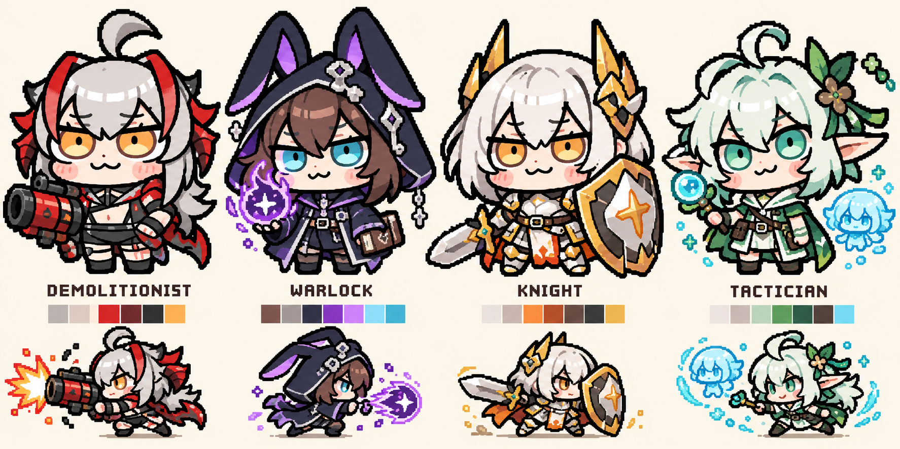
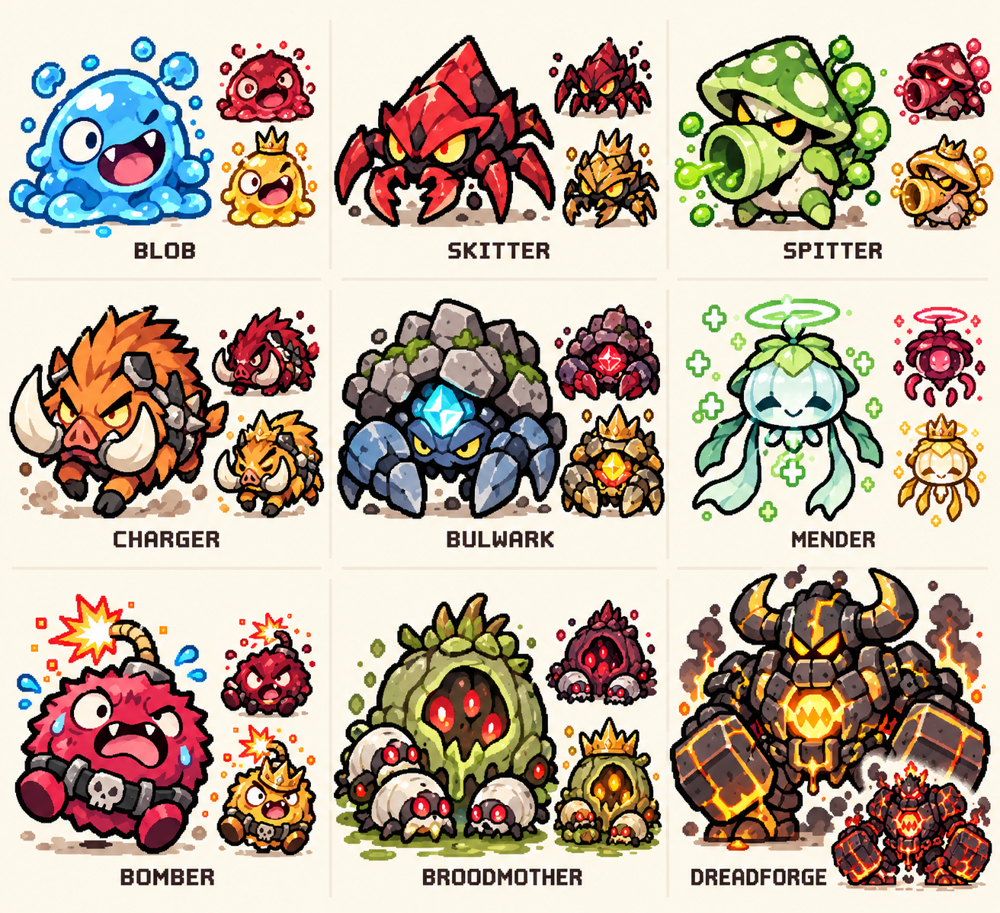
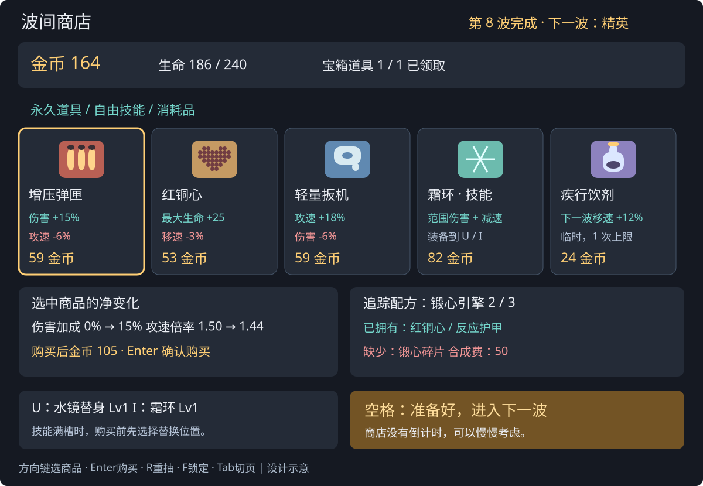
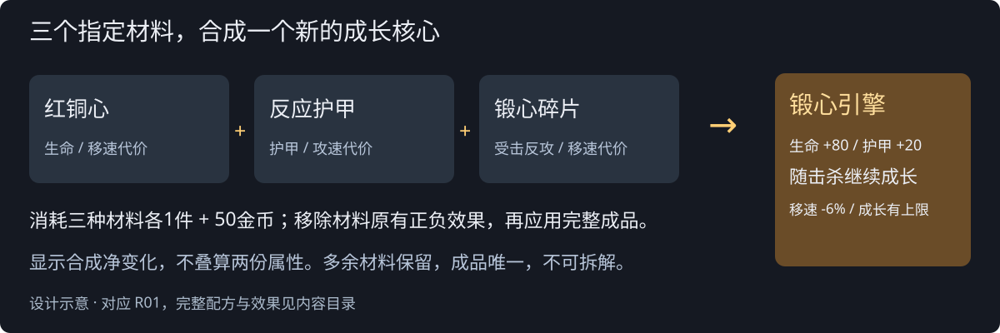
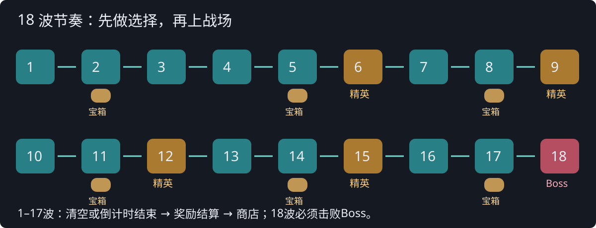

# 后续迭代美术备忘（不进入本轮验收）

用户于2026-10-20决定本轮先实现玩法逻辑。以下是保留的原美术方向，不是当前执行任务，不要求绘图、改精灵或复刻SVG。

# V0.2 美术与界面设计

状态：**新绘制的概念母版与界面设计，不是已经替换到游戏里的精灵或截图。**

## 方向：先画出表情，再做像素规格

V0.1 的问题不是分辨率不够，而是角色更像“用色块拼出来的小人”，脸、身体和武器的主次没有体现参考图的喜剧感。V0.2把头部、眼神、短小身体与夸张轮廓作为第一验收目标，不再用“有64×64 PNG”代替风格验收。

- **爆破手**：银灰蓬松发、夸张呆毛、红黑角形装饰、黄橙半睁大眼、小小w嘴与腮红；头大身短，发射器比手臂大，但不挡住脸。
- **术士**：棕发、长耳兜帽、蓝紫术式、认真又困倦的眼神；不是把爆破手头发换色。
- **骑士**：白金短发、小型角状头饰、厚盾与短靴；眼神自信但身体敦实，盾牌轮廓远看就能认出。
- **战术家**：薄荷白发、尖耳、绿色短外套、好奇表情；水形分身复用其可识别脸型，而不是无特征圆球。

玩家界面名称只出现“爆破手、术士、骑士、战术家”。V0.1的角色称呼仅留在历史档案和迁移映射中。

### 生产资源要求

- 约1.4–1.6头身，脸/头发占主体高度约70%；粗深色轮廓、聚合的像素色块、清楚的大眼/眉/嘴，避免碎色噪声。
- 概念图不是可直接裁用的动画表。后续需逐角色绘制 **96×96透明帧**，实际场内显示约64–72逻辑像素；保持脚底锚点与12碰撞半径，视觉大头不扩大受击范围。
- 四向待机2帧、行走4帧、攻击2帧、受击1帧；可镜像左右，但武器朝向与轻自瞄不能矛盾。八向技能指示独立于身体四向朝向。
- 先交爆破手一套可动样板，放进正常地图、1280×720与1920×1080实际窗口审阅，再推广其余三人。用“表情、比例、剪影、与参考接近程度”验收，不用文件尺寸代替。
- 本轮只交概念设计；不把这张大图直接缩小成4个新PNG就宣称完成重绘。

## 怪物：先看形状就知道该怎么应对

| 中文 / 图中标签 | 轮廓与行为 | 首次出现建议 |
| --- | --- | --- |
| 团团怪 / BLOB | 不对称大眼的软胶体，直接追击 | 第1波 |
| 镰足虫 / SKITTER | 三角硬壳、六足和大钳，快速绕侧 | 第2波 |
| 喷菇 / SPITTER | 蘑菇帽与炮口嘴，停顿后发射孢子弹 | 第3波 |
| 冲锋猪 / CHARGER | 圆胖猪身、大獠牙，明显蓄力后直冲 | 第4波 |
| 盾壳蟹 / BULWARK | 宽大石盾、蟹脚与发光弱点，慢速挡路 | 第5波 |
| 灯灵 / MENDER | 漂浮灯罩、长流苏与治疗光环，优先治疗队友 | 第7波 |
| 爆爆兽 / BOMBER | 圆鼓炸弹身体、引线与慌张表情，靠近后自爆 | 第10波 |
| 巢母 / BROODMOTHER | 种荚巢壳和幼虫，有限次数召小怪 | 第13波 |
| 裂隙炉王 / DREADFORGE | 大角熔炉巨偶、巨大双锤、明显核心，第二阶段裂甲 | 第18波 |

- 普通怪采用48×48或64×64透明帧，Boss建议192×192；不再以彩色圆圈加文字作为最终外观。
- 每种怪可有2–3套配色变体，用种子稳定抽取；**纯配色变化不暗改数值**。强化行为必须同时有轮廓配件/图标，不能只靠红黄颜色传达。
- 精英增加冠饰、护甲或体型和独有预警，区别于普通红色变体；Boss半血裂甲应从造型上可见。
- 敌方伤害预警统一暖红/橙纹理；友方施法颜色按职业区分。普通敌人不常驻长名称，受伤时短暂显示血条，精英/Boss保留名字，降低当前战场文字遮挡。

## 商店：先看净变化，再做决定

上方只放金币、生命、下波类型与结算完成状态。中间5件货物，卡片同屏显示价格、收益和代价。选中卡下面显示“购买后的属性与金币”，右侧显示追踪配方缺件。底部常驻U/I与下一波按钮。

- 默认键盘：方向键选卡，Enter购买/确认，R重抽，F锁定，Tab切换“货架/装备/配方”页，空格准备下一波。
- Enter第一次进入购买/替换确认，第二次确认；长按不重复买。药剂允许明确的“再买一个”，仍遵守金币与单波上限。
- 负面属性用下降箭头、明确文字和暖红色共同表达；不能只用颜色，也不能在滚动区藏代价。
- 合成材料缺件直接显示名称与进度；可合成时出现高亮动作，不把合成埋在道具详细页。

## 战斗与结算界面

- 战斗顶部：波数、倒计时、金币；左侧生命/护盾与经验；底部J/K/L/U/I和闪避。用短提示显示“金币+3”“战利品资格+1”，不打断战斗。
- 波末：先展示金币与击杀简报，随后按队列处理宝箱二选一、精英核心三选一、海克斯；每个面板都说明剩余待领取数量。
- 宝箱战斗中只显示破碎与资格增加；不弹道具选项、不立刻增加属性。第18波结束直接结算，无商店按钮。
- 构筑面板用B查看，显示来源分组与净属性；战斗打开时暂停，关闭后明确恢复。界面要把“临时饮剂”“永久道具”“核心”“配方成品”“海克斯”分开，而不是一个越来越长的文字列表。
