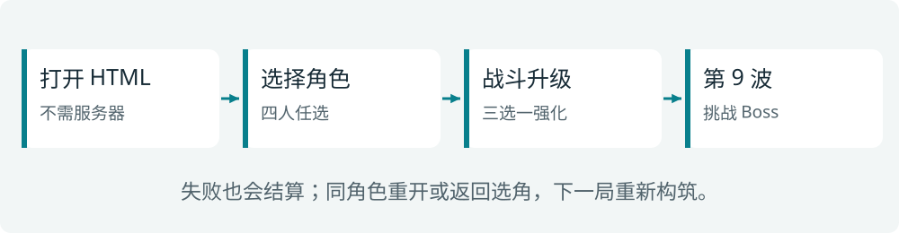
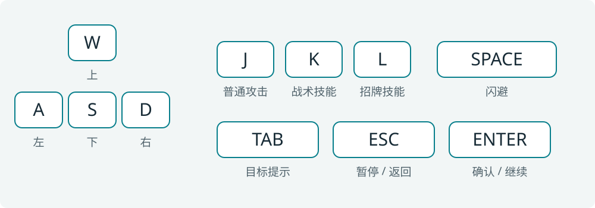
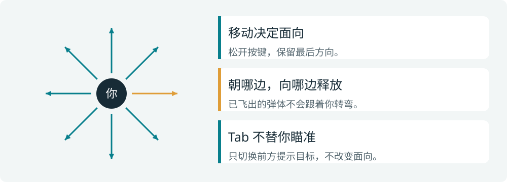
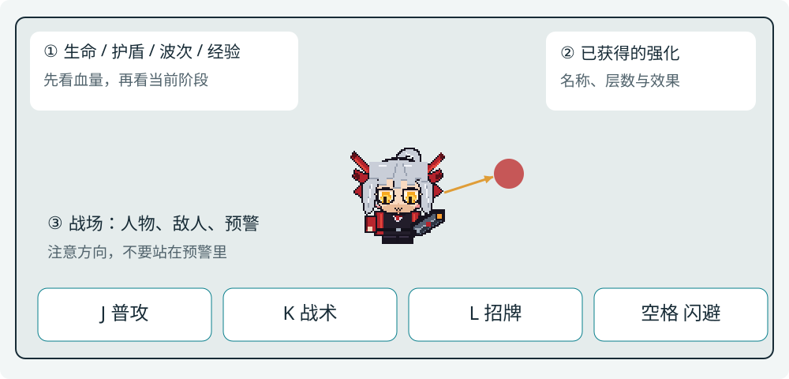
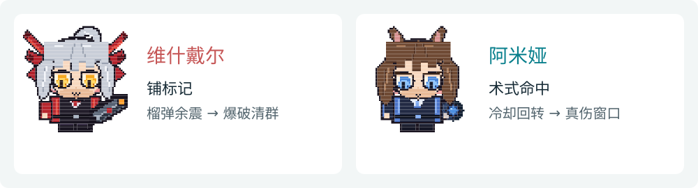
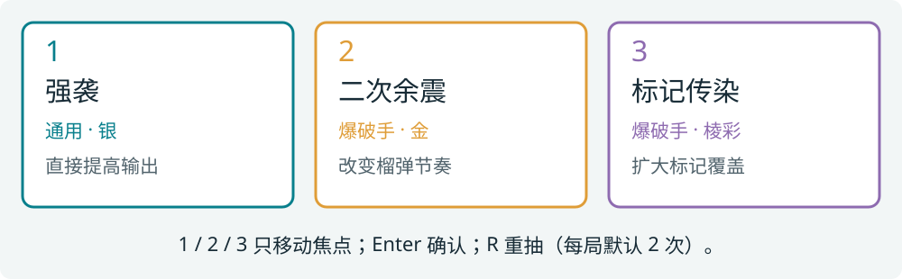
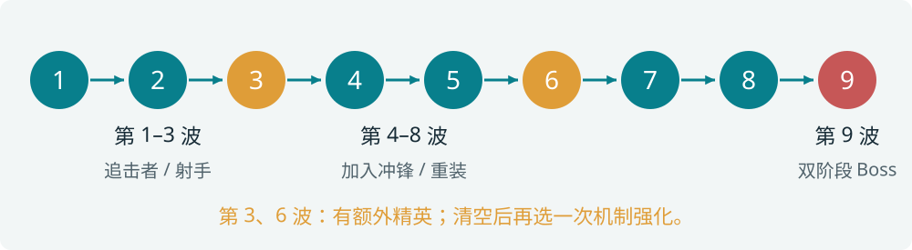
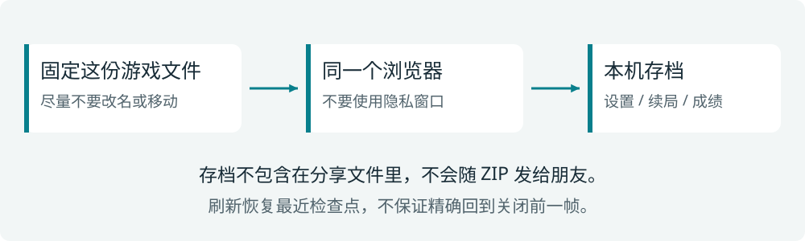

# 像素回响：泰拉试炼
## 游戏说明书

**四名角色，一套键盘，九波挑战。**

你操控一名 Q 版像素角色，在俯视竞技场里移动、攻击、闪避；击败敌人获得经验，选择强化，逐步组成自己的打法。第 9 波是最终 Boss。

这是一款桌面浏览器单人动作肉鸽原型。角色形象参考《明日方舟》，技能经过适合实时动作玩法的改编。本手册介绍的是这个游戏的实际规则，不是原作角色攻略。

**先记三个动作**：WASD 移动，按住 J 攻击，空格闪避。

版本 0.1 · 内容核对日期 2026-10-20 · 建议横屏、键盘与有声环境

<!-- pagebreak -->
# 01｜三分钟开始第一局

1. 下载并解压分享包，双击 **像素回响.html**，用浏览器打开。
2. 按 Enter 开始，用方向键或 WASD 选择角色，再按 Enter 确认。
3. 等待 3 秒倒计时。先移动，再沿面向按住 J 攻击，不要站在敌群中不动。
4. 升级时选一张强化；每波清空后按 Enter 继续。生命归零或击败 Boss 后结算。

## 默认键位

菜单通常用方向键或 W/S 移动焦点，Enter 确认。战斗键可以在设置里重绑；手册中的 J/K/L 指默认键位。切换输入法后无响应时，先切回英文输入并点一下游戏区域。

<!-- pagebreak -->
# 02｜方向，比锁定更重要

- W/A/S/D 可组合成八向移动，斜着走不会更快。松开后，保留最后面向。
- J 和定向技能朝当前面向释放；允许空射。连射中转身只影响后面射出的弹体。
- Tab 只是切换前方的目标提示，不会替你转身或自动瞄准背后的敌人。
- 静止时闪避沿最后面向。闪避持续 0.18 秒，前 0.15 秒无敌，冷却 3 秒，不能穿墙。
- 自身治疗、领域与变身按自身生效；召唤物会自行选择目标。

**先看生命与护盾，再看技能冷却。**右侧构筑区告诉你已经获得哪些强化；下方技能条显示当前键位和就绪状态。切到别的窗口会自动暂停，返回后需明确继续。

<!-- pagebreak -->
# 03｜远程角色：爆破与术法

## 维什戴尔：用标记放大爆炸

基础生命 **110**。J 是较慢的榴弹：命中后产生溅射，并在 0.35 秒后发生余震。带残影的敌人受到余震时，会额外爆炸并短暂眩晕。

- **K 魂灵之影｜14 秒冷却**：召唤一个持续 12 秒的魂灵，为附近尚未标记的敌人附着残影并减速。
- **L 爆裂黎明｜30 秒冷却**：接下来 6 发榴弹伤害翻倍，溅射半径提高 50%；20 秒未使用的弹药失效，空射也会消耗。
- **打法建议**：先用 K 铺标记，再朝聚集的敌群开火；不要因为大招亮着就停在原地挨打。

## 阿米娅：把握真伤窗口

基础生命 **100**。J 是快速直线术式；每 5 次 J 命中，使 K 的剩余冷却减少 1 秒。

- **K 精神爆发｜9 秒冷却**：0.8 秒内连续发射 6 发术式；每发沿当时面向，结束后有 0.5 秒不能普攻，但仍能移动和闪避。
- **L 奇美拉｜30 秒冷却**：持续 8 秒，J/K 转为真实伤害并增伤 60%；结束后 3 秒减速 25%、不能 K/L。
- **打法建议**：找到安全位置再爆发，提前为虚弱阶段留好撤退方向。这个游戏不会照搬原作的强制退场。

<!-- pagebreak -->
# 04｜防护与召唤角色

## 塞雷娅：近身输出，但不是无敌

基础生命 **180**、护甲 **35**。J 是面前 100° 扇区的盾击，范围较短，带击退。

- **K 急救配置｜10 秒冷却**：回复 40 生命，获得 25 护盾，护盾持续 4 秒、不叠加。
- **L 钙质化｜28 秒冷却**：8 秒内自身周围形成领域，每秒回复 8 生命；敌人减速 35%、受到法术伤害提高 30%，盾击附加法伤。
- K 确实恢复生命时，会让 L 剩余冷却减少 2 秒；满血施放不会获得这次回转收益。
- **打法建议**：靠近后用扇面同时打多个敌人，但仍要避开冲锋和密集弹体。

## 缪尔赛思：选择流形的工作方式

基础生命 **105**。J 发射水弹，开局带一个近战流形。

- **K 塑形｜6 秒冷却**：切换近战/远程形态，保留生命百分比；流形死亡时改为重建。
- **近战流形**：承伤并近身攻击，命中可逐步增加自身攻击与护甲。
- **远程流形**：每 8 次攻击生成一个临时副本，默认最多一个副本；切回近战会移除远程副本。
- **L 浅层非熵适应｜24 秒冷却**：近战形态聚敌并眩晕；远程形态刷新已有副本寿命，攻击附带束缚。主流形不存在时，需要先重建。

<!-- pagebreak -->
# 05｜强化不是装备清单，是打法选择

击杀敌人掉落经验，靠近吸取。波次结束会自动吸取剩余经验。最高等级 **9**，每次升级最大生命增加 5 并回复 5，随后进行三选一。

## 怎么选

- A/D 或方向键移动焦点，1/2/3 可直接把焦点移到对应卡；**最后仍要 Enter 确认**。
- R 重抽当前三张，每局默认共有 **2 次**，不是每次升级都补满。
- 同一手不会出现重复卡；角色专属卡只属于当前角色，已达层数上限的卡不会继续出现。
- 银、金、棱彩是强化稀有度，不等于任何情况下都该拿最稀有的牌。先看它是否适合当前打法。
- 第 3、6 波清空后，额外再获得一次机制强化选择。

## 可以尝试的组合

| 角色 | 组合 | 改变了什么 |
| --- | --- | --- |
| 维什戴尔 | 二次余震 + 标记传染 | 更频繁触发余震，向周围铺开残影 |
| 阿米娅 | 穿透术式 + 心绪共鸣 | 一发打多个敌人，更快获得技能回转 |
| 塞雷娅 | 回生冲击 + 坚盾反击 | 把治疗与护盾转化为近身输出 |
| 缪尔赛思 | 双生流形 + 水镜共鸣 | 增加副本容量，配合补攻增强输出 |

这些是机制搭配建议，不是保证通关的固定配方。没有抽到组合，也可以继续用现有强化完成这一局。

<!-- pagebreak -->
# 06｜九波里，你会遇到什么

第 1–3 波的普通敌人由追击者和射手构成；第 3 波额外出现精英冲锋者。第 4–8 波加入普通冲锋者和重装者，第 6 波另有精英重装者。每波必须清空，不是等计时结束自动过关。

| 敌人 | 你应该观察什么 | 应对方向 |
| --- | --- | --- |
| 追击者 | 不断靠近的身体 | 留移动空间，边拉开边转身攻击 |
| 射手 | 朝你飞来的弹体 | 横向移动，不长时间停在同一射线上 |
| 冲锋者 | 冲锋前的预警 | 不沿冲锋路线后退，优先向侧面避开 |
| 重装者 | 高生命与护甲 | 借助法术、真伤或强化输出，不被它堵住 |
| 失控实验体 | 第 9 波 Boss，半血后进入第二阶段 | 注意弹幕缺口、地面预警和冲锋，先保留闪避 |

每波开始有 3 秒倒计时。波间恢复最大生命的 **15%**，准备好后按 Enter。生命归零立即结束；与 Boss 同帧死亡按失败处理。

游戏没有局外永久战力成长。重开后重新选择强化，保留的是本机设置和成绩记录，不是上一局的战斗增益。

<!-- pagebreak -->
# 07｜暂停、续玩与常见问题

**Esc 暂停；切换窗口也会自动暂停。**回到页面后按 Enter 明确继续。不要把浏览器仍在显示画面误认为战斗已经恢复。

游戏在波初、波间和强化选择等检查点保存。重新打开后，从主菜单选择“继续试炼”；恢复后先暂停，确认后继续。它不是每帧存档，刷新可能回到最近检查点。最近 **10 局**成绩会保存在本机。

| 遇到的情况 | 先这样处理 |
| --- | --- |
| 按键没反应 | 点击游戏区域；退出输入框；切回英文输入；检查是否处于暂停或强化选择 |
| 能移动但打不到 | 先转向敌人再 J；Tab 不会改变弹道，射程外不会命中 |
| 没有声音 | 先按一次确认键，再检查游戏静音和系统音量 |
| 找不到以前的存档 | 用原浏览器、原文件位置；不要用隐私窗口。换文件名、移动文件或清除站点数据可能影响存储 |
| 提示不能保存 | 本局仍可玩，但不要依赖续局；改用允许本地存储的普通浏览器窗口 |
| 窗口太小、文字拥挤 | 使用桌面横屏，建议至少 1280×720；先恢复浏览器默认缩放 |

单文件版的本地存储受浏览器对 file:// 的规则影响。分享 HTML 或 ZIP 不会把你的浏览器存档一起发给朋友。

<!-- pagebreak -->
# 08｜通用强化速查

所有角色都可能获得以下强化。名称与效果取自当前游戏配置；同类效果的叠层上限不同。

<!-- catalog:general:start -->
| 名称 | 稀有度 / 上限 | 效果 |
| --- | --- | --- |
| 强袭 | 银 / 3层 | 所有自身与召唤物伤害 +12%。 |
| 轻装 | 银 / 3层 | 移速 +8%。 |
| 蓄能 | 银 / 3层 | K/L 冷却缩减 +8%。 |
| 生存训练 | 银 / 3层 | 最大生命 +20，获取时回复 20 生命。 |
| 余烬扩散 | 金 / 1层 | 自身击杀敌人后产生半径 50、12 法伤爆炸，不再次触发本卡。 |
| 战术回响 | 金 / 1层 | K 生效后下次 J 追加一次 50% 伤害攻击，5 秒未使用失效。 |
| 闪避脉冲 | 金 / 1层 | 闪避终点产生半径 65、20 法伤脉冲并减速 20% 持续 1 秒。 |
| 极限回转 | 棱彩 / 1层 | K/L 冷却期间每累计击杀 10 个敌人，各减少剩余冷却 2 秒。 |
<!-- catalog:general:end -->

选择页面已经显示名称、稀有度与效果。拿不准时，优先补足眼前短板：经常被追上考虑移动；技能空档太长考虑冷却；近身生存吃紧考虑生命与防护。

<!-- pagebreak -->
# 09｜远程角色专属强化

## 维什戴尔

<!-- catalog:vishdal:start -->
| 名称 | 稀有度 / 上限 | 效果 |
| --- | --- | --- |
| 二次余震 | 金 / 1层 | 每发榴弹多一次延迟 0.7 秒的 50% 伤害余震。 |
| 标记传染 | 棱彩 / 1层 | 残影引爆给周围最多 2 个未标记敌人附着标记，不连锁引爆。 |
| 亡魂伴行 | 金 / 1层 | 魂灵上限变为 2；K 每次仍只召唤一个。 |
| 追加装药 | 棱彩 / 1层 | 爆裂黎明弹药 6→9，最后一发范围额外 +25%。 |
<!-- catalog:vishdal:end -->

## 阿米娅

<!-- catalog:amiya:start -->
| 名称 | 稀有度 / 上限 | 效果 |
| --- | --- | --- |
| 穿透术式 | 金 / 1层 | J 可额外穿透 2 个敌人，后续命中伤害 70%。 |
| 心绪共鸣 | 金 / 1层 | 情绪吸收由每 5 次命中变为每 3 次。 |
| 双重吟唱 | 棱彩 / 1层 | K 结束 0.5 秒后追加 3 发、每发原伤害 60% 的术式。 |
| 意志余辉 | 棱彩 / 1层 | 奇美拉持续时间 8→11 秒；虚弱不再减速，但仍禁用 K/L。 |
<!-- catalog:amiya:end -->

专属强化改变自己的角色机制，不会让其他角色获得同一套招式。强化后的冷却、资源与技能说明，以游戏界面实际显示为准。

<!-- pagebreak -->
# 10｜防护与召唤专属强化

## 塞雷娅

<!-- catalog:saria:start -->
| 名称 | 稀有度 / 上限 | 效果 |
| --- | --- | --- |
| 回生冲击 | 金 / 1层 | K 按实际治疗量的 80% 对半径 100 敌人造成法伤。 |
| 钙质反应 | 棱彩 / 1层 | 钙质化领域每秒对敌人造成 16 法伤，享受领域法伤增益。 |
| 坚盾反击 | 金 / 1层 | 护盾吸收伤害时触发半径 85、18 物伤反击，内置冷却 0.8 秒。 |
| 充能循环 | 棱彩 / 1层 | 精神回复减冷却 2→4 秒；领域累计 5 次有效治疗后 K 剩余冷却减少 1 秒。 |
<!-- catalog:saria:end -->

## 缪尔赛思

<!-- catalog:muelsyse:start -->
| 名称 | 稀有度 / 上限 | 效果 |
| --- | --- | --- |
| 双生流形 | 棱彩 / 1层 | 远程副本上限 1→2，近战形态攻击窃取层数上限 5→8。 |
| 生态复苏 | 金 / 1层 | 主流形每秒恢复最大生命 2%，L 开启时立即恢复 20%。 |
| 聚合涡旋 | 金 / 1层 | 近战 L 拉拽范围 +30%；远程 L 束缚时间 +0.25 秒。 |
| 水镜共鸣 | 棱彩 / 1层 | 玩家 J 命中时主流形补一次 40% 伤害攻击，内置冷却 0.6 秒。 |
<!-- catalog:muelsyse:end -->

下一局可以尝试另一种构筑：同一个角色不必总按相同顺序拿牌。先熟悉基础移动和面向，再追求强化组合。
