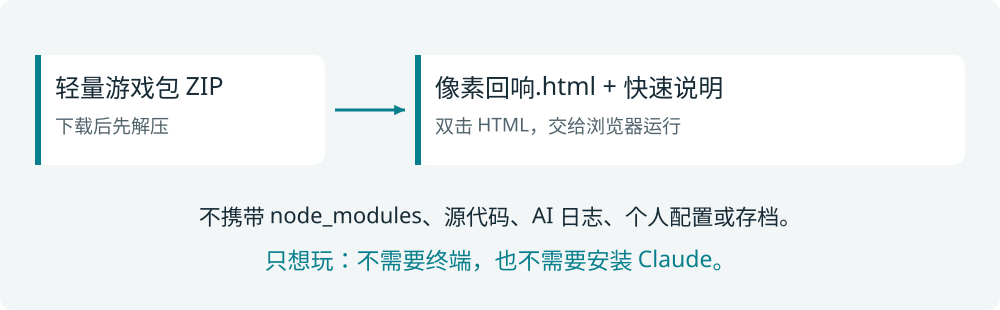

# 分享与启动指南
## 发给朋友，只发游戏包

分享版的运行入口是 **像素回响.html**。它把生产 JavaScript、样式和游戏图片放进同一个文件，接收者不需要 Node、Python、Claude、API Key 或本地服务器。



## 接收者怎么打开

1. 将 ZIP 下载到本机并解压，不要在聊天软件的附件预览器里运行。
2. 双击“像素回响.html”，或右键选择浏览器打开。
3. 页面出现主菜单后按 Enter，选择角色开始。
4. 如果浏览器阻止本地脚本或存储，换普通浏览器窗口；不要为了运行游戏关闭系统安全保护。

**只打开游戏，不要运行开发命令。**分享包不包含 AI 工程工具，也不需要登录模型服务。

游戏包与图文文档包分开交付。只想快速试玩，发轻量游戏包；想完整了解玩法，再附游戏说明书 PDF。MD 和 SVG 用于后续修改手册，不是运行依赖。

<!-- pagebreak -->
# 存档不是游戏文件的一部分


## 对接收者的提醒

- 设置、键位、续局和成绩保存在浏览器本机存储中，不会写回 HTML。
- 同一个文件换浏览器或换位置后，可能看不到原存档；把常用游戏文件留在固定文件夹里。
- 隐私窗口、浏览器清理、存储权限限制都可能影响保存；不要把续玩当作跨设备云存档。
- 更换分享版之前先保留旧 HTML；当前游戏没有“导出/导入存档”按钮。

## 发出之前

只打包运行成品与必要说明。不要把 `node_modules/`、`.git/`、`.claude/`、`.memory/`、测试日志、截图全集、个人配置和浏览器 profile 一并发送。

角色形象参考《明日方舟》，参考图由用户提供，游戏像素资源由本项目代码绘制。分享包用于个人试玩；本项目没有提供这些角色的公开商用授权。第三方软件许可随游戏包的 `THIRD_PARTY_NOTICES.txt` 保留。

<!-- pagebreak -->
# 如果你是项目维护者

## 从源代码重新制作分享版

需要 Node.js 24 或更高版本，并进入项目目录：

```bash
npm install
npm run build:share
```

生产网页输出到 `dist/`；单文件分享版输出到 `output/share/game/像素回响.html`。两者用途不同：`dist/` 用于静态服务器，单文件版用于本机双击打开。

## 原始开发版怎么启动

```bash
npm run dev -- --port 5343 --strictPort
```

打开 `http://localhost:5343/`。若本工程服务已运行，直接打开即可；端口被其他工程占用时先确认归属，不要随意杀掉别人的服务。

## 分享版验证范围

已在 macOS 的 Chrome 155 独立浏览器中关闭网络，以 file:// 打开产物，确认菜单、四角色图片、选角进入战场与本机检查点保存；没有捕获 HTTP 资源请求，错误列表为空。

**首次打开仍请人工检查 WASD 移动、J 攻击和 Esc 暂停。**字母键自动化未正确传递键位，聊天内置浏览器也不支持 file://，所以没有把原生键盘兼容性记录为全部通过。具体范围见 `output/share/build-report.json`。

四角色全流程自动通关已由用户主动跳过，不因为制作分享包而重新执行；本次包装不会证明游戏难度已完成平衡。
