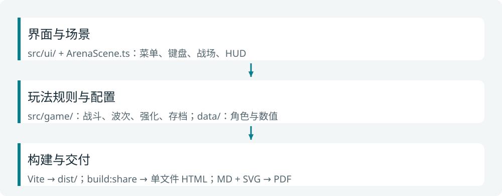

# 项目现状与维护指南
## 先知道现在交付了什么

这是一个本地单页游戏原型，核心源码与运行资源都已在项目内。它没有后端、数据库、账号系统或运行时模型调用。

**截至2026-10-26**：V0.2逻辑队列62项通过、2项用户跳过；V0.3由Codex直接完成美术接入，类型/lint/1675项单测通过。人工18波与性能/泄漏检测仍未补做，不能由贴图升级推断其结果。

| 已实现 | 具体范围 |
| --- | --- |
| 操作与角色 | 八向移动、面向施法、闪避、四角色差异技能、J/K/L 与 U/I 自由技能槽 |
| 一局玩法 | 18 波（第 18 波唯一 Boss）、6/9/12/15 精英波、宝箱、等级 15、48 种海克斯 |
| 构筑与经济 | 波间商店、永久道具 I01–I24、药剂 P01–P08、自由技能 S01–S12、精英核心 E01–E08、合成 R01–R06、金币账本 |
| 界面与存储 | 主菜单、选角、帮助、设置、暂停、商店、构筑面板 B、结算、本机续局与最近 10 局成绩 |
| 工程交付 | TypeScript + Vite + Phaser 3；本地静态构建；单文件分享 HTML 与 ZIP；Markdown / SVG 人类文档 |



<!-- pagebreak -->
# 接手时先看这几个入口

| 要做什么 | 从哪里开始 |
| --- | --- |
| 修改玩家看到的界面 | `src/ui/`、`src/style.css`、`index.html` |
| 查找场景接线与渲染 | `src/game/scenes/ArenaScene.ts` |
| 修改角色、敌人、波次数值 | `src/game/data/`，再核对对应纯逻辑模块 |
| 修改战斗、海克斯、道具或存档规则 | `src/game/` 下对应模块和 `tests/` |
| 重画角色与场地 | `tools/generate-assets.mjs`；输出到 `public/assets/`（美术迭代延期，本轮不新增图形） |
| 制作轻量分享版 | `tools/release/build-share.mjs` 与 `npm run build:share` |
| 打包游戏 ZIP / 文档 ZIP | `python3 tools/docs/package_delivery.py` |
| 修改这套手册 | `docs/human/*.md`、`docs/human/figures/*.svg` |

## 日常开发与交付

```bash
npm run dev -- --port 5343 --strictPort
npm run typecheck
npm run lint
npm run test
npm run build
npm run build:share
python3 tools/docs/package_delivery.py
```

只改文档时，不需要重新跑四角色游戏；修改规则后跑受影响测试，发布前再检查构建和关键界面。角色图片改过时，必须看实际画面，不能只看 PNG 是否存在。

`ArenaScene.ts` 承担较多场景接线。增加能力时优先把纯规则留在独立模块，避免继续把所有逻辑塞进场景类；这是维护建议，不代表本次已经做了结构重构。

<!-- pagebreak -->
# 验收结果：通过与跳过分开看

## V0.2 已有证据

- 构建：`npm run build` 成功，产出 `dist/`；`npm run build:share` 产出单文件 HTML，资源全部内联。
- 体积：大小按实际字节记录，不设硬上限；具体数值以 `output/share/build-report.json` 与 `output/share/delivery-manifest.json` 为准。
- 内联静态检查：无外部 script/link/modulepreload、无远程资源 URL、无 `__PIXEL_ECHO_DEV__`/`__PIXEL_ECHO_DIAG__` 开发桥、无开发入口参数、无截图目录或凭证标记。
- typecheck 与 lint 通过。功能与浏览器验收的最终结论以独立 Validator 记录为准，不在本手册中替代。

## 用户主动跳过的部分

- **US-066 人工 18 波普通构筑试玩**：用户于 2026-10-25 明确要求跳过，未执行。保持 `blocked=true、passes=false`，不得改写成“已通关”或“全部 64 项通过”。
- **US-051 性能/泄漏检测**：用户于 2026-10-25 明确要求跳过，未运行 60 秒压力与 5 次重开检查。不得宣称 V0.2 达到 50 FPS 或无泄漏。

历史 V0.1 基线曾记录 589 个测试通过，以及 macOS/Chrome 压力场景平均 58.25 FPS；这些是 V0.1 的旧证据，**不适用于 V0.2**，也不作为本轮性能承诺。

## 分享包装的额外核对

单文件版的离线打开、主菜单→选角→战斗与占位资源显示由独立 Validator 以 `file://` 复核；原生字母键的自动化复核受工具限制，保留首次运行的人工检查项。分享版验证文件分发与离线兼容，不重新承诺已跳过的通关或性能结果。

## 当前边界

这是单人桌面原型，不含联机、账号、云存档、永久战力、移动端触控或手柄支持。难度和长局手感不应仅由测试数量推断。美术已升级为V0.3；源图与构建入口见`docs/art/README.md`。

# 文档、记录与维护分工

## 给人阅读

- `docs/human/01-游戏说明书.md`：玩家操作、角色、强化与续玩。
- `docs/human/02-分享与启动指南.md`：发包、打开、存档限制与重建命令。
- 本文件：实现范围、维护入口、验收事实与已知边界。
- `output/pdf/`：这三份文档的 PDF；SVG 原图随 MD 保留。

## 保留给工程追溯

`tasks/`、`scripts/ralph/prd.json`、`progress.txt`、`docs/patterns-*.md` 与 `docs/project-state-*.md` 仍保留。它们记录开发过程，不是玩家说明书，也不进入轻量分享包。

自动开发循环在 V0.2 交付后结束。玩游戏用 `npm run dev` 或离线 HTML，不要用本手册重新启动 Harness。

## 后续修改的安全习惯

1. 先 `git status`，保留现有未提交改动和本机存档。
2. 用功能分支改代码，检查受影响测试与实际画面。
3. 重新构建分享文件；在解压后的副本上验证打开，而不是只验开发服务器。
4. 发布前检查包里没有私密配置、日志或浏览器数据；保留软件许可说明。
5. 如果需要换模型重新自动开发，应单独确认新任务范围，不沿用已经结束的故事清单。
